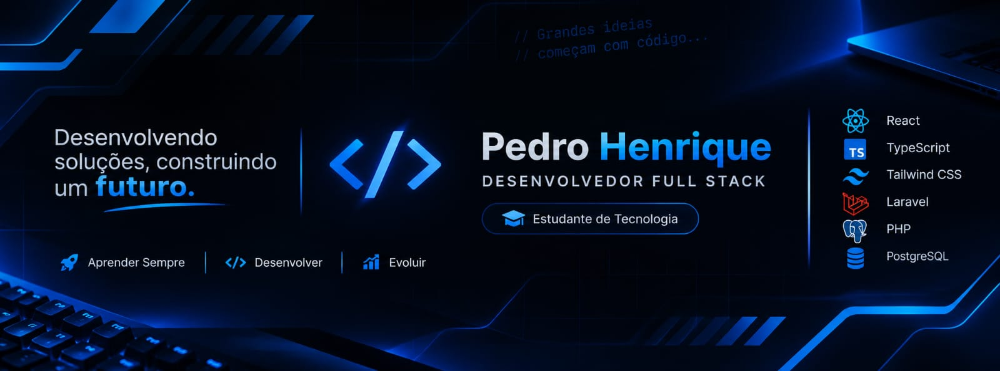

<div align="center">
  
</div>

<br/>

<div align="center">

# Pedro Henrique

### Full Stack Developer & Builder | Estudante de Tecnologia


<br/>

<p>
  <a href="#sobre-mim"></a>
  <a href="#stack"></a>
  <a href="#projetos"></a>
  <a href="#estatisticas"></a>
  <a href="#contato"></a>
</p>

</div>

---

<div id="sobre-mim"></div>

## 📌 Sobre Mim


Sou um desenvolvedor Full Stack em constante evolução, com foco em criar **soluções reais**, escrever código com propósito e transformar conhecimento em impacto prático.

A tecnologia me atrai pela possibilidade de **resolver problemas complexos, gerar valor de negócio e construir liberdade**. Encaro a programação como uma ferramenta fundamental para erguer produtos digitais, abrir novas oportunidades e impulsionar o crescimento técnico e pessoal.

Meu objetivo principal é consolidar uma base de excelência em **Engenharia de Software**, projetando sistemas escaláveis, organizados, seguros e prontos para o mundo real.

<br/>

<p>
  
  
  
  
</p>

<br clear="right"/>

---

<div id="stack"></div>

## 🛠️ Stack & Tecnologias

Organização das tecnologias e ferramentas com as quais construo aplicações modernas:

<br/>

### 🌐 Frontend
<p align="left">
  
</p>

### ⚙️ Backend & APIs
<p align="left">
  
</p>

### 🗄️ Bancos de Dados
<p align="left">
  
</p>

### 🔧 Ferramentas, DevOps & Ambiente
<p align="left">
  
</p>

---

## 🎯 Filosofia de Trabalho & Engenharia

```bash
while (true) {
    compreender_problema();
    arquitetar_solucao();
    escrever_codigo_limpo();
    testar_e_otimizar();
    entregar_valor_real();
}
```

- **Entender o problema antes de codar:** Código eficiente começa com clareza dos requisitos.
- **Pragmatismo com qualidade:** Soluções simples, elegantes e manuteníveis superam complexidade desnecessária.
- **Aprendizado por construção:** A melhor forma de dominar tecnologia é colocando produtos no ar.
- **Constância e disciplina:** Evolução técnica é fruto de repetição intencional diária.

---

<div id="projetos"></div>

## 🚀 Projetos em Destaque

<table>
  <tr>
    <td width="50%" valign="top">
      <h3 align="center">⚡ NEEDS</h3>
      <p align="center">
        
      </p>
      <p>
        <strong>SaaS de agendamento e gestão de serviços</strong>, concebido para oferecer uma experiência de usuário intuitiva, automação de fluxos operacionais e arquitetura robusta para uso real.
      </p>
      <p>
        <strong>Stack Principal:</strong><br/>
        <code>React</code> • <code>Node.js</code> • <code>Laravel</code> • <code>PostgreSQL</code> • <code>MySQL</code>
      </p>
      <p><strong>Destaques:</strong></p>
      <ul>
        <li>Interface moderna, responsiva e focada na jornada do usuário</li>
        <li>Modelagem relacional para múltiplos prestadores e serviços</li>
        <li>Estrutura modular e preparada para escalabilidade</li>
      </ul>
    </td>
    <td width="50%" valign="top">
      <h3 align="center">💼 Dev Portfolio</h3>
      <p align="center">
        
      </p>
      <p>
        <strong>Portfólio profissional</strong> projetado para demonstrar evolução técnica, projetos entregues, organização de código e capacidade de desenvolvimento de interfaces sólidas.
      </p>
      <p>
        <strong>Stack Principal:</strong><br/>
        <code>React</code> • <code>TypeScript</code> • <code>Tailwind CSS</code> • <code>Vercel</code>
      </p>
      <p><strong>Destaques:</strong></p>
      <ul>
        <li>Apresentação profissional com design clean e dark mode</li>
        <li>Código tipado, componentizado e modular</li>
        <li>Otimização de performance e deploy automatizado</li>
      </ul>
    </td>
  </tr>
</table>

---

<div id="estatisticas"></div>

## 📊 Estatísticas no GitHub

<div align="center">
  
  &nbsp;
  
</div>

<br/>

<div align="center">
  
</div>

<br/>

### 🐍 Contribuições em Movimento

<div align="center">
  
</div>

---

<div id="contato"></div>

## 📬 Conecte-se Comigo

Vamos trocar uma ideia sobre tecnologia, parcerias ou novos projetos?

<br/>

<div align="center">
  <a href="mailto:pedromatos999997@gmail.com" target="_blank">
    
  </a>
  &nbsp;
  <a href="https://www.linkedin.com/in/pedrohtech/" target="_blank">
    
  </a>
  &nbsp;
  <a href="https://instagram.com/sx_costax" target="_blank">
    
  </a>
</div>

<br/>

---

<div align="center">

> 💡 *“Disciplina constrói o que motivação nunca sustenta.”*

<br/>

  
</div>
